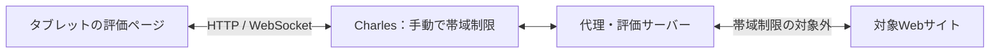

# タブレット実機評価の設計

通信速度は実験者がCharlesで手動設定する。評価機構は速度ごとの確認、初回収集と5回測定、結果保存を担当する。操作手順は [tablet.md](tablet.md) を参照する。

## 通信経路と役割



- タブレット：対象URL・速度・端末情報・撮影開始の待機条件を送信し、画像の描画時間を測る。
- Charles：実験者が上下の帯域・遅延・プロキシの適用範囲を設定する。
- 評価サーバー：手動設定の確認を待ち、仮想ブラウザを動かし、画像送信・結果検証・保存を行う。
- 仮想ブラウザ：対象サイトへ直接アクセスする。Chromeは `--no-proxy-server` で起動する。

評価機構にCharlesのWeb Interface操作や帯域検証用のデータ転送は含めない。旧 `CHARLES_CONFIG`・`CHARLES_CREDENTIALS` は参照しない。終了・停止時もCharlesの設定は実験者が管理する。`CHARLES_VERSION` は結果へのバージョン記録だけに使用できる。

## 実行の順序

1. クライアントはURL一覧、128 / 200 / 300 / 1024 kbpsから選んだ速度、端末情報、待機条件を `evaluation:start` で送る。
2. サーバーは新しい実行用フォルダと結果DBを作る。
3. 各速度の開始時に `evaluation:speed-required` を送り、利用者がCharlesを設定して確認ボタンを押すまで待機する。
4. `evaluation:speed-confirmed` を受けたら、その速度を申告値として保存する。実効速度を検証した扱いにはしない。
5. WebSocketを接続し直し、手動変更後の接続で測定を始める。
6. URLごとに新しい仮想ブラウザのコンテキストと収集用DBを作り、初回収集1回と測定5回を順に実行する。
7. 全画像の描画と結果のDB保存が終わってから次のアクセスへ進む。
8. 次の速度では再度手動設定の確認を待つ。終了時にはExcelを保存する。

手動確認には試行のIDとは別のIDを割り当て、別の速度の確認通知を使い回さない。接続し直すためのトークンを結果やログに含めない。

## ページの取得と画像化

通常画面の `src/server/index.ts` と評価用の `src/server/evaluation/worker.ts` は、共通の `src/server/rendering/page-renderer.ts` を呼び出す。ページ取得、初回候補の収集と監視終了、XPathによる部分画像の撮影、ビューポート撮影、候補の処理結果の生成をこのクラスに集約する。WebPの縮小処理は `src/server/rendering/image.ts` に集約し、通常画面のスクロール画像にも使う。

評価ワーカーはブラウザコンテキストとDBの用意、試行順序、終了時の片付けを担当する。評価の反復実行・手動設定確認・結果の検証と保存は `controller.ts` が担当する。通常側と評価側のWebSocket送信は、それぞれ共通の描画処理から受け取ったフレームを送る。

待機条件とタイムアウトは共通処理への引数とする。通常側は `networkidle2`・30秒、評価側は開始時に選んだ待機条件・60秒を使う。評価の全6アクセスで待機条件を統一する。

| 保存値             | 待機内容                                                       |
| ------------------ | -------------------------------------------------------------- |
| `networkidle2`     | 通信数が2以下の状態が500ms続くまで待機。従来の既定値           |
| `load`             | loadイベントまで待機                                           |
| `domcontentloaded` | DOMContentLoadedイベントまで待機。画像の読み込み完了は待たない |

待機条件はクライアントから代理サーバーへ送る設定であり、Charlesの設定とは独立している。条件によって撮影時点と収集候補が変わるため、`config.json` とExcelに記録する。タイムアウト時に別の条件へ自動変更しない。

初回は `lcp.js` のPerformanceObserverでLCP候補のXPathと時刻を収集し、ビューポート画像を取得した後に監視を終了する。未通知分を取り出し、DB書き込み完了を待つ。子フレームや別アクセスの通知を混入させない。

2〜6回目は候補を追加せず、初回に保存したXPathをLCP値の降順で探し、要素の部分画像を先に送る。最後にビューポート画像を送る。非表示要素を強制表示せず、候補なし・要素なし・描画領域なし・画像化エラーは理由を記録する。

画像はWebPにし、必要に応じて幅を縮小して1枚64,000バイト以下にする。この上限は画像Bufferのサイズであり、JSON化したWebSocketメッセージの転送量の上限ではない。

共通化するのはサーバーの描画処理である。通常と評価でブラウザのキャッシュ・Service Worker・コンテキスト・画面寸法の設定、およびクライアントのCanvas描画方法には違いがある。描画処理が共通でも、これらの条件が異なる測定値を同一条件とは扱わない。

## 時間計測と結果の確定

開始時刻はクライアントが `evaluation:trial-start` を送信する直前、終了時刻は最初の画像をCanvasに `drawImage()` した直後とする。同じ端末の `performance.now()` の差で求める。

計測値は要求通信、サーバーでのページ取得・画像化、画像転送、端末での画像読み込み・描画を含む。手動設定の確認待ちとWebSocketの再接続は含めない。ブラウザ標準のLCPや、物理画面への表示完了を直接測る値ではない。

最初の描画時刻と画像IDを保持し、すべての画像を描画した後に結果を返す。サーバーは送信した画像IDと描画済みIDの一致、重複の有無、計測値の範囲を検証する。DB保存を完了してから次の試行へ進む。

## 測定条件と保存

- 指定URLと速度ごとにDBとブラウザコンテキストを新規作成する。同じ条件の6アクセスでは保持する。
- リダイレクト後も指定URLをDBのキーにし、遷移後URLは別途記録する。
- 仮想ブラウザのHTTPキャッシュを無効化し、Service Workerをバイパスする。DNSやCDNのキャッシュは消去しない。
- 実機のUser-AgentとCSS寸法を仮想ブラウザへ設定する。仮想ブラウザDPRは1、実機DPRは別途保存する。
- 初回の表示時間は保存するが、中央値から除く。
- 5回成功した条件だけ、全5値の中央値を出す。5回ともLCP部分画像が最初に描画された場合は、その中央値も別列に出す。
- 速度は手動設定の申告値である。保存形式の `speedMode` は既存結果との互換性のため `external-unverified` に固定する。

```text
evaluation/results/tablet-<時刻>-<ID>/
  config.json          # URL・速度・待機条件・端末情報・バージョン
  results.db           # 実行・条件・試行・候補処理・手動設定確認履歴
  collected/1.db       # URLと速度の条件ごとの初回収集DB
  results.xlsx
```

Excelは「中央値」「測定値」「候補処理」「測定条件」「速度設定」の5シート。速度設定シートには確認時刻・速度・未検証であることを残す。通常の `json.db` とPCクロールのDBは流用しない。

## 停止と検証

利用者の停止、タブの非表示、画面サイズの変更、接続切断では進行中の試行を無効化し、取得済み結果を保存する。サイトの失敗はその条件を終了して次へ進み、自動再試行はしない。不完全な5値から中央値を作らない。

タイムアウトは手動設定確認10分、再接続15秒、ナビゲーション60秒、試行180秒。実行中は別の評価と通常の仮想ブラウザ操作を受け付けない。SIGINT / SIGTERMでは停止・保存を待って終了する。

テストでは通常サーバーと評価ワーカーに同じ固定ページと寸法を使い、初回画像・候補画像・縮小後のWebPのバイト列と座標、非表示候補のスキップ結果が一致することを確認する。速度ごとの手動確認前に対象サイトへアクセスしないこと、初回＋5回の描画と保存、旧Charles設定が残っていても手動評価できること、待機条件の伝達、途中停止、リダイレクトも確認する。実機と手動設定したCharlesの経路・帯域の確認は実験者が行う。
