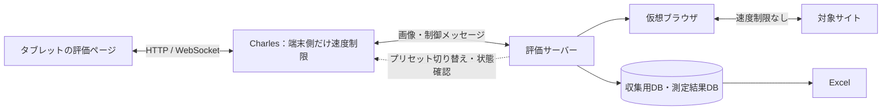
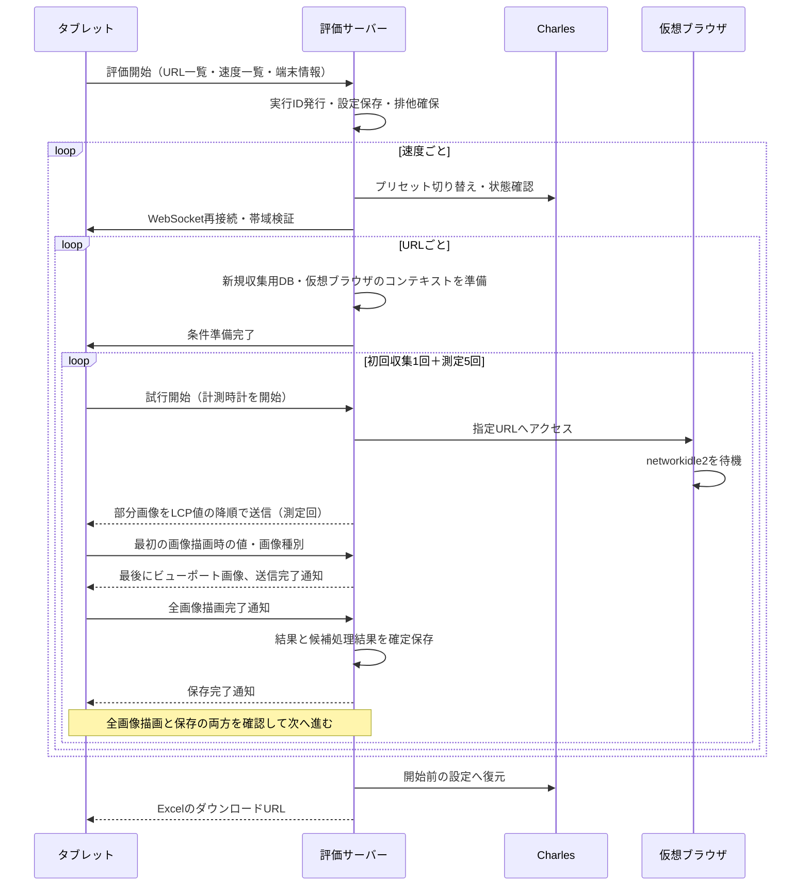

# タブレット実機による自動評価の設計案

作成日：2026-10-26。実装前のたたき台。既存のPCクロールと区別して実機評価を追加する。

## 1. 目的と測定条件

タブレットで評価ページを一度開き、「測定開始」を押すと、URL一覧を自動巡回する。PCによる実機ブラウザの遠隔操作は行わない。

| 項目             | 案                                                            |
| ---------------- | ------------------------------------------------------------- |
| 対象URL          | `evaluation/urls.json` から選択。開始時に一覧を固定して保存   |
| 通信速度         | 128 / 200 / 300 / 1024 kbps。上下同一、追加遅延0ms            |
| 順序             | 速度ごとにURL一覧を順番に処理。実行順を記録                   |
| 各条件のアクセス | 初回収集1回＋測定5回（2〜6回目）                              |
| 集計             | 5回すべて有効な場合だけ中央値を算出                           |
| 端末             | iPadまたはAndroidタブレット。機種・OS・ブラウザは実験前に固定 |
| User-Agent       | 実機の `navigator.userAgent` を記録し、仮想ブラウザにも設定   |
| 画面             | 向き・評価領域のCSSピクセル寸法を固定し、DPRを別途記録        |

本設計の表示時間は「URLの要求を送信する直前から、最初の受信画像を `drawImage()` でCanvasへ描画した直後まで」。ブラウザ標準のLCPや、画面への物理的な表示完了時刻とは区別する。既存の測定タイミングを維持する。

## 2. 構成と責務



Charlesと評価サーバーは同じPCでもよい。タブレットのWi-FiプロキシにCharlesのIP・ポートを設定し、評価ページにはサーバーのLANアドレスで接続する。例：Charles `192.168.1.10:8888`、評価ページ `http://192.168.1.10:3000/evaluation`。

| コンポーネント | 担当                                                                   |
| -------------- | ---------------------------------------------------------------------- |
| 評価ページ     | URL巡回、試行開始、画像描画、端末時計での計測、進捗表示、停止要求      |
| 評価サーバー   | 試行の受理・照合、初回収集、画像送信、Charles制御、結果保存、Excel生成 |
| 仮想ブラウザ   | `networkidle2` 待機、LCP値の降順で部分画像化、最後にビューポート画像化 |
| Charles        | タブレットと評価サーバー間の帯域・遅延を制限                           |

評価ページのJavaScriptはCharlesを直接操作しない。認証情報を端末へ配布せず、サーバーから操作する。サーバー側の対象サイトへの通信にはCharlesやCDPの速度制限を適用しない。

初版は実行中の評価を1台・1件に限定する。現状の仮想ブラウザは共有されているため、実験中の通常利用や別端末の評価開始は受け付けない。

## 3. Charles連携

Charlesに4速度のプリセットを事前登録し、Web Interfaceを有効にする。登録名と速度の対応をサーバーの設定ファイルに記載する。

| kbps | 上下それぞれのB/s |
| ---- | ----------------: |
| 128  |            16,000 |
| 200  |            25,000 |
| 300  |            37,500 |
| 1024 |           128,000 |

Charles公式が案内しているのは、Web Interfaceによる登録済みプリセットの有効化・無効化である。固定のREST APIや任意の帯域値設定APIを前提にしない。利用するCharlesのバージョンでWeb画面のリクエストを確認し、専用の連携処理に閉じ込める。

連携処理の操作案：`getStatus()`、`selectPreset(speedKbps)`、`restore(previousStatus)`。実際の制御URL・HTTPメソッド・認証方式は、導入環境で確定する。`http://control.charles/` への要求自体もCharlesをプロキシとして経由させる。

速度切り替えは次の手順とする。

1. 前の試行の画像描画・保存がすべて終了していることを確認する。
2. Charlesのプリセットを切り替え、選択状態と有効状態を確認する。HTTP応答成功だけでは完了としない。
3. タブレットへ切り替え完了を通知し、評価用WebSocketを再接続する。再接続中も実行IDと所有端末を保持する。
4. 帯域検証を行い、成功後に評価ページへ条件の準備完了を通知する。

プロキシの選択状態と実効速度は別に記録する。タブレットへ既知サイズの圧縮されにくいデータをWebSocketで送り、受信時間とバイト数から検証する。画像用WebSocketの経路・Charlesの適用範囲に合わせ、検証時は圧縮による短縮を避ける。各速度の開始時に実施し、サイトの5回測定には含めない。

検証サイズ・繰り返し数・許容誤差は実験前に固定する。暫定案は256,000バイト×3回、目標帯域からの誤差±20%。接続開始等の影響を含むため予備実験で妥当性を確認する。検証不合格時は本測定へ進まない。仮想ブラウザ側が制限対象外であることも事前確認する。

正常終了・停止・切断時は開始前のCharles設定へ戻す。復元失敗は画面とログに残す。サーバー異常終了では自動復元を保証できないため、次回起動時に未終了記録と現在の設定を確認する。

参考：[Web Interface](https://www.charlesproxy.com/documentation/using-charles/web-interface/)、[帯域・遅延の制限](https://www.charlesproxy.com/documentation/proxying/throttling/)、[端末のプロキシ設定](https://www.charlesproxy.com/documentation/configuration/browser-and-system-configuration/)。

## 4. 自動評価の流れ



初回はLCP候補を収集し、部分画像を送らずビューポートを送る。初回収集の判定はアクセス開始時に確定し、初回画像取得までの全通知と未通知候補を保存して監視を終了する。子フレームや別試行の通知は除外する。

2〜6回目は初回候補を再利用し、収集用DBへ候補を追加しない。要素なし・描画領域なし・画像化エラーは理由を記録して次候補へ進む。全候補をスキップしてもビューポート画像を送る。

画像の読み込みは非同期なので、送信順から最初の描画を推測しない。実際に最初に描画した画像のID・種類・XPathを端末から報告する。

30サイト×4速度なら、初回収集120回＋集計対象600回。初回収集・帯域検証の値は中央値に含めない。

## 5. メッセージと完了判定

既存の `image` / `lcp` / `complete` 等を基に、実機評価用の識別情報と通知を追加する。以下は名称を含めた案であり、未実装。

| 方向          | 操作・通知                   | 主な情報                                                    |
| ------------- | ---------------------------- | ----------------------------------------------------------- |
| 端末→サーバー | `evaluation:start`           | URL一覧、速度一覧、UA、CSS寸法、DPR、画面の向き、端末申告名 |
| サーバー→端末 | `evaluation:condition-ready` | runId、conditionId、指定URL、速度、次の試行ID               |
| 端末→サーバー | `image`                      | runId、conditionId、trialId、指定URL                        |
| サーバー→端末 | 画像                         | trialId、frameId、kind、XPath、既存の画像・座標             |
| 端末→サーバー | `lcp`                        | trialId、最初のframeId、表示時間、描画種別、XPath           |
| サーバー→端末 | `complete`                   | trialId、送信画像数、候補ごとの処理結果                     |
| 端末→サーバー | `evaluation:rendered`        | trialId、描画済みframeId一覧                                |
| サーバー→端末 | `evaluation:trial-saved`     | trialId、確定状態、次の試行IDまたは条件完了                 |
| 双方向        | 停止・エラー通知             | runId、trialId、理由                                        |

`phase`（初回収集／測定）と試行番号はサーバーの計画から決定し、端末の申告だけで変更できないようにする。

次の試行の開始条件は、送信完了通知、全frameIdの描画、最初の表示時間の受領、サーバーの保存完了がすべて揃うこと。制御メッセージを画像ハンドラーへ渡さない。重複する表示時間通知はtrialIdで一意に保存し、同じACKを返す。過去の試行や別実行の画像・通知は集計しない。

## 6. 保存とExcel

```text
evaluation/results/<runId>/
  config.json          # URL順・速度順・端末情報・Charlesバージョン等
  results.db           # 実行状態・各試行・候補処理・Charles操作履歴
  collected/001.db     # URLと速度の組み合わせごとの初回収集DB
  collected/002.db
  results.xlsx
```

収集用DBは既存の `url` / `lcp` テーブルを利用する。指定URLをキーにし、遷移後URLは別項目で保存する。異なる実行や速度の候補を混ぜない。

測定結果DBには実行、条件、試行、候補処理、Charles操作履歴を分けて保存する。trialIdには一意制約を設け、DBの書き込み完了後に保存完了を通知する。

各試行に、指定URL・遷移後URL、速度、初回／測定、番号、表示時間、描画種別、XPath、成功・失敗理由、送信・描画枚数、開始終了日時を記録する。時刻の差分には端末の `performance.now()` を使い、PCと端末の時計を引き算しない。Charlesのプリセット・選択確認・実効帯域検証結果も条件に紐付ける。

既存のExcel出力を拡張する。

- `中央値`：5値、全5回の中央値、初回値、候補数、評価可否。5回すべてLCP画像が最初の場合だけLCP先行描画の中央値も出す。
- `測定値`：各試行の値・有効性・描画種別・ビューポートへの切り替え理由。
- `候補処理`：候補ごとのXPath、元のLCP値、送信／スキップ／エラー理由。
- `測定条件`：端末、UA、CSS寸法、DPR、向き、キャッシュ、順序、サーバー・Chrome・Charlesのバージョン、実装コミット。
- `速度制御`：要求速度、プリセット、切り替え成否、検証結果、復元結果。

途中停止時も保存済み結果を出力する。無効な試行を除いて5件未満になった場合は中央値を空欄にし、成功件数と理由を表示する。

## 7. 実機で揃える条件と失敗時の扱い

- 仮想ブラウザのHTTPキャッシュを無効化し、Service Workerをバイパスする。収集DBは同じ条件の6アクセスで保持する。
- 評価ページは `Cache-Control: no-store` とし、Service Workerを登録しない。受信画像は試行ごとに新しいBlobから描画する。端末の全ブラウザキャッシュを通常のJavaScriptで消去できるとは想定しない。
- DNS・TLS接続等の再利用は残る。同じ条件の6アクセスではブラウザを保持し、URL・速度の条件が変わる際は新しいコンテキストを使う。この方針を結果に明記する。
- 実機のUAを仮想ブラウザへ伝える。PCクロール用のiPhone固定UAは実機評価に適用しない。
- 向き・評価領域・タブの表示状態を監視する。非表示化・画面ロック・リサイズ・通信切断が起きた試行は無効にして評価を停止する。画面の自動ロックは実験前に解除する。
- デコード失敗時も無期限に待たず、失敗を通知する。タイムアウトは処理段階ごとに記録する。
- 暫定タイムアウトはナビゲーション60秒、1試行全体180秒、Charles制御10秒。低速条件と画像枚数を含めて予備実験で調整する。異なる設定で得た値を混在させない。
- Charles制御失敗・実効帯域検証不合格は全体を停止する。初回収集失敗はその条件を中止する。
- 測定試行の失敗はそのまま残し、成功するまでの自動再試行はしない。残りを続行する場合も、前試行のナビゲーション停止と残留画像・通知の処理を完了してから開始する。隔離できなければ条件を中止する。
- 再接続で途中の試行を成功扱いにしない。新規実行では新しいDBを作る。プロセス再起動からの自動再開は初版の対象外とする。

## 8. 実装の分割と検証

既存処理の広いリファクタリングは行わず、次の単位で実装・検証・コミットする。

1. 実機評価ページとモード分岐：制御メッセージ受信、進捗・停止表示。通常利用とPCクロールを維持する。
2. 実機での初回＋5回巡回：試行ID・画像IDによる完了待ち、実機情報の反映、既存の収集・画像化処理の再利用。
3. 結果の永続保存とExcel：重複排除、途中停止・無効試行、既存の `evaluation/report.mjs` を利用した出力。
4. Charles連携：設定確認、プリセット切り替え、WebSocket再接続、帯域検証、終了時の復元。
5. 実機の予備実験：固定ページで帯域・描画順・6アクセス・候補固定を確認後、少数の実サイトで測定。

実装候補は `src/client/tablet-evaluation.ts`（巡回制御）、`src/server/evaluation/`（実行管理・保存・Charles連携）、既存 `index.ts`（接続点）とする。型は既存の通常リクエストと区別できる判別可能な型を追加する。構成を大きく変更しない。

主な検証項目は、URLが変わっても候補を再利用できること、2〜6回目に候補が増えないこと、描画順が送信順と異なる場合も最初の画像を識別できること、非表示・要素なし・デコード失敗・切断・Charles不調で有効な中央値を捏造しないこと。最後にCharlesログと既知サイズの転送で、実機のWebSocketだけが制限されることを確認する。

## 9. 実装前に確定する事項

| 未確定事項                                  | 暫定方針                                                                                                                                     |
| ------------------------------------------- | -------------------------------------------------------------------------------------------------------------------------------------------- |
| タブレットの機種・OS・ブラウザ              | 実機のUAを使用。同一実験内では固定                                                                                                           |
| Charlesのバージョン・プリセット名・制御操作 | 実環境のWeb Interfaceを確認して設定化                                                                                                        |
| 端末とサーバーのネットワーク                | 同一LANを想定。WebSocketがプロキシを迂回しないことを検証                                                                                     |
| 帯域検証の許容誤差・サイズ                  | 予備実験後に固定し、本測定途中では変更しない                                                                                                 |
| CSS寸法とDPR                                | 現行クライアントはCSS寸法をDPRで除算しているため、実機の意図する描画領域と一致するか確認。評価ページではCSS寸法を送信し、DPRは別途保存する案 |
| 実験順序による偏り                          | 初版は速度→URLの固定順。必要なら実行単位の順序入れ替えを追加し、順序を保存                                                                   |
| Safari等での状態変化検出                    | 取得可能なイベントを機種ごとに確認。検出できない画面ロック等は実験者の記録を併用                                                             |

この文書は実装案であり、タブレット巡回・Charles自動制御・実機用Excel保存はまだ実装していない。
